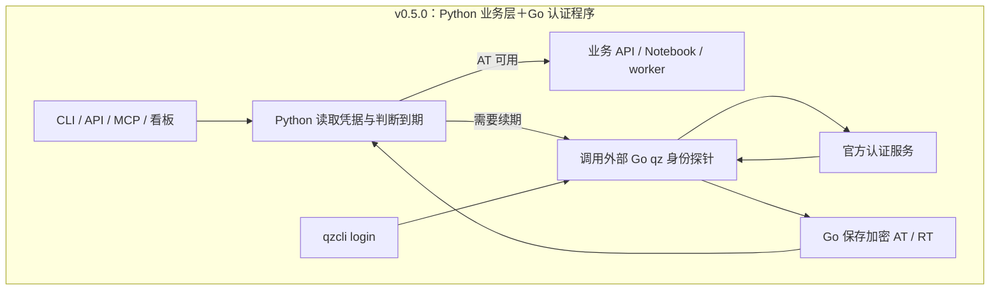
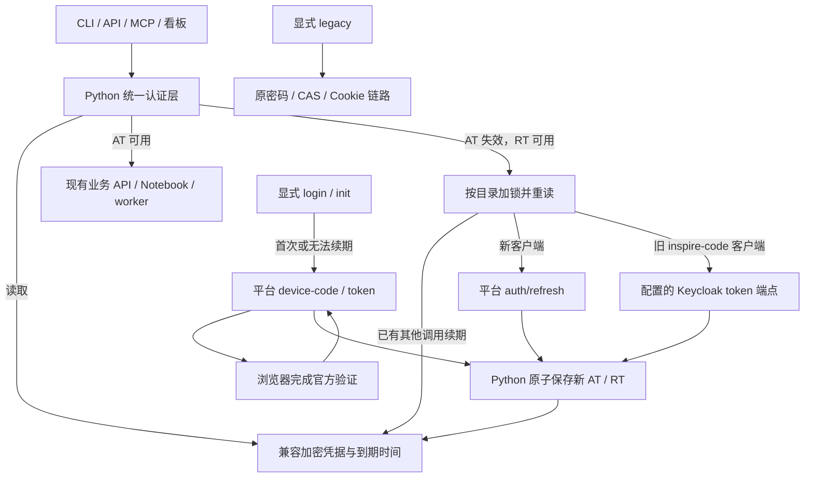

# Python 原生官方 OAuth：实现与验收

本页记录 Python 原生官方设备码 OAuth 的实现与验收。相比依赖外部 Go `qz` 的 v0.5.0，v0.6.0+ 完全由 Python 原生完成设备码授权与自动续期。平台 Keycloak 已于 2026-11-18 晚停用 `offline_access` 离线刷新权限（旧 `typ=Offline` 令牌刷新会返回 `invalid_grant`），因此默认 scope 已对齐官方 `qz v1.0.0` 收敛为 `openid profile email`，并新增 `qzcli auth refresh` 主动续期保活命令与旧 `Offline` 令牌自动替换逻辑。

OAuth 是官方授权协议；设备授权让用户在浏览器完成平台登录与双因子验证，命令行仅持有令牌。访问令牌（AT）用于业务请求，刷新令牌（RT）换取新 AT。旧 Cookie 历史约一天、刷新授权历史约六天是迁移动机，实际窗口以服务端为准；不是每次刷新都会重新延长六天。

## 从 v0.5.0 到本候选版





没有新增 Go、InspireSkill 或浏览器运行时依赖。设备授权参考其公开协议并独立实现；不执行上游安装脚本。旧密码/Cookie 路径只在显式 legacy 使用。

## 请求、凭据和到期决策

新设备授权默认使用 `POST /api/v1/public/auth/device-code`，JSON scope 为 `openid profile email`（与官方 Go `qz v1.0.0` 一致；桌面交互终端自动打开确认页，`--no-browser` 或 SSH/无界面环境自动跳过）。由于平台已停用 `offline_access`，本地若仍残留旧 `typ=Offline` 令牌，`qzcli auth status` 会标记 `offline_deprecated=true` 并提示告警，执行 `qzcli login`（无需额外传 `--reauth`）即可直接覆盖为新的在线会话令牌（`typ=Refresh`）。针对在线会话约 12 小时 `SSO Session Idle` 闲置回收与约一周 `MaxLifespan` 上限，提供两层保障：（1）定时执行 `qzcli auth refresh` 主动轮换令牌重置 12 小时闲置计时；（2）管线与 Agent 可设置 `QZCLI_AUTH_MODE=auto`（或在 `~/.qzcli/config.json` 设 `"auth_mode": "auto"`），平时走 OAuth，OAuth 到期时自动无感回退本地 CAS 会话续跑，一旦遇到图形验证码、二次验证或密码冲突则 **0 次重试立即熔断**，并提示用户直接运行 `qzcli login` 在浏览器点确认恢复。解析层仍保留对 `exp=0` / `refresh_expires_in=0` 的防御处理，不会误判为 1970 年过期。

平台新客户端使用 JSON `POST /api/v1/public/auth/refresh`。旧 Go 凭据的公共客户端是 `inspire-code`；当前实测该 RT 送入平台网关返回 HTTP 400 `invalid_grant`，原 Keycloak 表单 refresh 成功。因此旧凭据采用配置的认证服务 `/realms/inf-internal/protocol/openid-connect/token`，表单字段为 `client_id=inspire-code`、`grant_type=refresh_token` 和 RT。根据已知客户端与配置的 issuer 选择协议；不从任意 JWT issuer 派生 URL，不在失败后换客户端盲试。

| AT | RT | 操作 |
|---|---|---|
| 有效 | 任意，包括已到期/缺失 | 直接请求 |
| 到期/缺失 | 可续期 | 锁内重读后刷新、整体落盘、继续 |
| 到期/缺失 | 到期/缺失 | 需要一次网页授权，不循环刷新 |
| 未知到期 | 存在 | 先真实身份检查；服务端 401 最多恢复一次 |
| 任意 | 服务端 invalid_grant | 保存脱敏原始证据，明确需要授权；本地 exp 不能证明会话有效 |
| 任意 | 403/429/网络异常 | 原样保留脱敏响应与异常链，不清凭据/重登/降级 |

默认目录仍为 `~/.config/inspire-cli`，兼容 `.encryption_key` 与 `credentials.enc`；保留原密钥及额外字段。新文件权限私有，AES-GCM 加密后原子替换；未知格式或损坏不覆盖。JWT exp 优先，无 exp 时使用响应到期元数据。每台机器独立授权；`QZCLI_HOME` 不隔离同一凭据目录内的刷新链。

qzcli 按目录协调线程和进程。锁内重读可复用新令牌，失败回执按凭据指纹去重，保留响应头、trace ID、正文。独立 Go `qz` 不遵守此锁，应避免同时混用两个刷新程序；已观察到外部写入时保留该版本。不能声称完全控制不遵守锁的外部写入者。

## 使用和诊断

```bash
qzcli --version
qzcli init
qzcli auth status --check
qzcli auth refresh --check   # 主动续期保活（可挂 cron/launchd 重置闲置超时）
qzcli list -c -w 分布式 -n 5
qzcli avail -v --lp -w 分布式
qzcli login --reauth   # 仅在明确需要建立新授权时
```

`--auth-mode native` 与旧名称 `qz` 均使用原生实现；返回 `auth_mode=qz, provider=native-oauth`，保留旧调用契约。`qz_binary=null` 表示不需要外部程序。`INSPIRE_TOKEN` 是静态覆盖，无法自动续期；检查真实模块位置、`QZCLI_HOME`、`QZ_CLI_CONFIG_DIR` 和状态 source，避免检查到另一份安装。不要输出凭据正文。

本轮 Mac 生产安装仍是 0.5.0，其当前 AT 到期后真实刷新及身份检查已成功；不能把 11 月 15 日的旧错误或旧 RT 截止时间当作本次根因。指定开发机实际安装为 0.5.0、没有 Go `qz`，默认目录里 AT/RT 均缺失。旧测试目录仍在，回读元数据确认其 RT 已于本轮检查前到期，不能换回目录后继续刷新；2224 则为另一份 0.4.18。后两者不能和 Mac 的凭据链混为一谈。

## 本轮验收和边界

验收的核心是 **login 建立授权之后，普通命令在 AT 到期时自动使用 RT，整个过程不调用交互登录**。不能用一次强制刷新或另一份已到期的旧 RT，替代用户反馈的具体故障链路。

- 已新增真正的子进程端到端回归：本地 HTTP 服务签发短 AT，CLI 执行 login，等待该 AT 自然到期，然后普通 list 自动 refresh、两枚令牌落盘，新 CLI 进程验证身份并复用；总共一次设备授权和一次 refresh。这里的服务是本地协议测试服务器，不冒充启智实机自然到期。
- 真实启智实测采用仅注入认证对象时钟的方法，将普通 list 的判断时间置于原 AT 的 exp 之后；未改系统时钟、缓存 exp，也未传强制刷新参数。普通命令触发一次真实 refresh、零次 login，真实非空列表与后续身份查询成功，两枚令牌均轮换落盘。此结果覆盖普通命令自动续期路径，仍不称为平台自然到期实测。
- 前后对照确认另一处错误处理缺陷：缺少认证诊断标记时，CLI 可吞掉 RT 不可用的错误并以空结果退出 0，缓存的失败也可能落入旧 Cookie 提示。现统一保留官方认证决策的诊断标记，使缺失/到期/缓存错误沿完整异常链输出；子进程回归覆盖首次及缓存的 HTTP 401 原始响应、trace ID 和重登边界。
- 用户本次“直接要求大登录”的具体触发命令和原始错误尚未取得，当前 Mac 正常，不能宣称已经找到这一次的唯一根因。开发机旧 RT 到期仅说明该旧样本无法续期；重新授权提示已暂缓，先核对实际失败路径。


- `python -m compileall -q qzcli tests`、完整 `unittest discover -s tests`：最初源码环境 731 项因缺可选 Streamlit 跳过 1 项；新增普通命令端到端回归并在独立干净 venv 安装看板依赖后，732 项全部通过、0 跳过。四个独立进程并发调用真实本地 HTTP 测试服务器，仅一次 refresh，后续读取新 RT；不是共享 Mock 的线程测试。
- 单测覆盖有效 AT 与失效 RT、分别到期、未知期限、静态覆盖、原子轮换与复用、并发/外部更新、存储损坏、设备轮询、旧客户端兼容、错误端点、完整脱敏响应及失败缓存。
- Mac 真实原生刷新成功，AT/RT 均轮换且落盘，新认证实例复用成功，真实身份检查成功。干净 venv 安装和 `pip check` 通过，PATH 不含 Go `qz` 时身份查询仍成功。
- Mac 已执行 `list -c -r -w 分布式 -n 3` 与 `avail -v --lp -w 分布式`；运行态列表当前本人任务为空；随后不加 `-r` 的列表实际返回任务，不算已覆盖任务详情/日志。Notebook exec 已读回目标机实际版本和状态。真实 MCP stdio 发现 17 个工具，认证与非空列表检查通过。看板 AppTest 实际拉取该空间数据，无认证或执行异常，指标与表格非空；零空闲整节点的容量提示不当成认证错误。
- 指定开发机已安装原生 dev，模块/MCP 导入和源码包 SHA-256 回读通过。默认目录无凭据，旧测试目录 RT 亦已到期，等待一次独立网页登录，再验身份、刷新、list/avail。未复制 Mac 令牌。
- 新登录完整浏览器闭环、开发机续期、新实现自然到期、真实 worker/非空日志及写操作尚未全部验收；不得用 v0.5.0 的旧结果替代。Windows/ARM Linux 未做原生实机验收。
- 未自动重提训练/评测，未解除业务暂停，也未合并或发布。发布前仍需按 CONTRIBUTING 完成原有闸门并分别核对 GitHub/Gitee。

术语已解释：OAuth、AT/RT、设备授权、Cookie、legacy、JWT exp、公共客户端/issuer、原子替换和刷新链；其他入口名称保留 CLI 原名。
